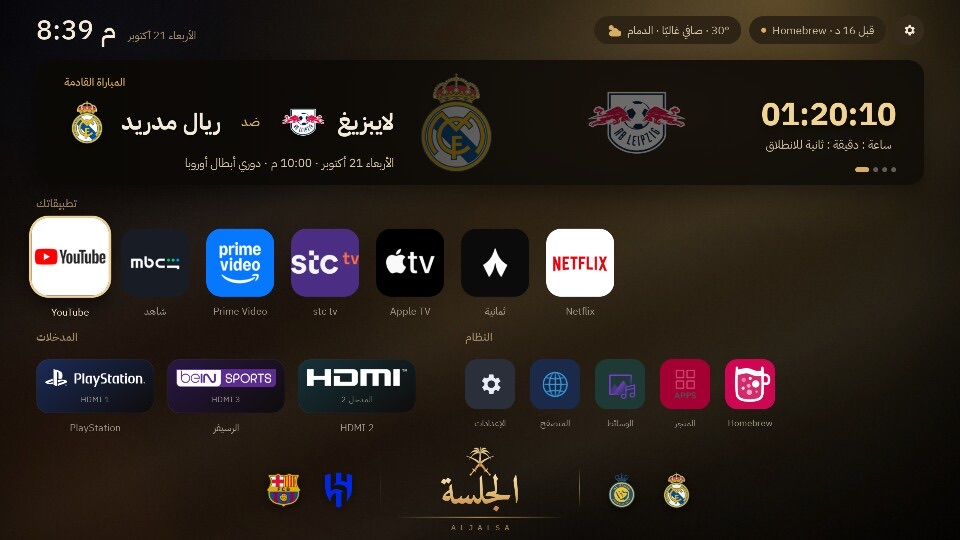
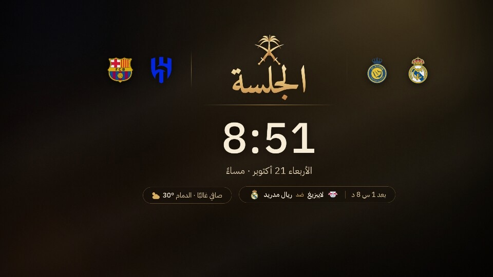

# WebOS — تعديلات الجلسة · Aljalsa mods for LG webOS

**شاشة رئيسية مخصصة لتلفزيونات LG webOS المروّتة** — تطبيقاتك، المدخلات، المباريات، تنبيهات دوري الأبطال فوق أي تطبيق، وشاشة توقف بهوية خاصة.
**A custom home screen for rooted LG webOS TVs** — your apps, HDMI inputs, match cards, Champions League alerts over any app, and a branded screensaver.



| شاشة التوقف · Screensaver | تنبيه هدف · Goal alert (over any app) |
|:---:|:---:|
|  |  |

> ⚠️ **مشروع غير رسمي · Unofficial.** يحتاج تلفزيون LG عليه روت (Homebrew Channel). غير LG وغير مرتبط فيها. اقرأ [docs/SAFETY.md](docs/SAFETY.md) قبل أي تثبيت.
> Needs a rooted LG TV (Homebrew Channel). Not affiliated with LG. Read [docs/SAFETY.md](docs/SAFETY.md) before installing.

**الفهرس · Contents:** [العربي](#العربي) · [English](#english) · [الوثائق / Docs](#الوثائق--docs)

---

## العربي

### 1. وش هو؟
واجهة ويب (HTML/CSS/JS بدون أي خطوة بناء) تشتغل **كشاشة رئيسية للتلفزيون** بدل واجهة LG الأصلية، ومعها:
- **خدمة جذرية صغيرة** (Node.js) تنفذ اللي ما تقدر عليه الصفحة: تشغيل وحذف التطبيقات، الصوت، وضع الصورة، تنظيف الذاكرة، قراءة زر Home، وتشغيل التنبيهات.
- **تطبيق نافذة شفاف** (`alert/`) يرسم بطاقة التنبيه **فوق أي تطبيق** شغّال (حتى Netflix).

جُرّبت على **LG webOS 7.5** (Chrome 87، شاشة 4K، رام 1.2 جيجا، ~350 ميجا متاحة). كل قرار تصميم مبني على ضعف هذا الجهاز (انظر [الأداء](#الأداء) و[docs/LESSONS.md](docs/LESSONS.md)). تلفزيونات webOS الأخرى المروّتة غالباً تشتغل لكنها غير مجرّبة.

### 2. المزايا بالتفصيل

| الميزة | الشرح |
|---|---|
| **صفوف منفصلة** | **تطبيقاتك** (المحمّلة)، **المدخلات** (HDMI بشعارات PlayStation وbeIN وHDMI الرسمية)، **النظام** (الأساسية فقط: إعدادات، متصفح، وسائط، متجر، Homebrew). |
| **اكتشاف تلقائي** | أي تطبيق تنزّله يظهر لحاله بأيقونته، وأي تطبيق تحذفه يختفي. القائمة تأتي من الخدمة لا من تخمين الصفحة. |
| **حركات ناعمة** | رفع وحلقة ذهبية عند الاختيار، ولون التطبيق يغمر الشاشة عند فتحه، وظهور متتابع عند التشغيل. 55–60 إطار/ثانية، ~25 ms من الضغطة للرسم. |
| **ضغط مطوّل (OK نصف ثانية)** | **نقل** بالأسهم، **إخفاء** (يرجع من الترس ← «إظهار المخفية»)، **حذف** فعلي من التلفزيون بتأكيد. يشتغل بالمؤشر كذلك. تطبيقات النظام وHomebrew محمية من الحذف. |
| **بطاقة المباراة** | المباراة القادمة لكل فريق في `TEAMS` (برشلونة، الريال، الهلال، النصر افتراضياً) من ESPN، بعدّاد `HH:MM:SS`، ونتيجة ودقيقة وقت اللعب. تتحدث كل ساعة + زر **تحديث يدوي**. يمين/يسار بين الفرق، OK لقائمة المباريات. |
| **تنبيهات دوري الأبطال** | من واجهة **UEFA** الرسمية: بداية، هدف (مع اسم اللاعب والدقيقة، وهدف عكسي/جزاء)، إلغاء هدف، بطاقة حمراء، ركلة جزاء، VAR، استراحة، نهاية. تظهر ببطاقة بتصميمنا فوق أي تطبيق. فحص كل 5 ثوان وقت المباراة، وينام لين دقيقتين قبل أول صافرة. ← [docs/ALERTS.md](docs/ALERTS.md) |
| **شاشة توقف** | بعد 3 دقائق خمول (`SAVER_MINUTES`): شعار الجلسة، ساعة كبيرة، طقس، المباراة القادمة. تخف بالليل وتتحرك ببطء لحماية الشاشة. تحل محل شاشة LG (وإعلاناتها). |
| **تنظيف الذاكرة** | يدوي من الترس، وتلقائي لو المتاح أقل من `AUTO_CLEAN_MB` (150 ميجا). يغلق تطبيقات الخلفية فقط ولا يحذف شي. |
| **لوحة الإعدادات السريعة (الترس)** | شبكة، بلوتوث، مخرج الصوت، مستوى الصوت، صوت التنقل، وضع الصورة، **إطفاء الشاشة مع بقاء الصوت**، تنبيهات الأهداف (تشغيل/إيقاف + بطاقة تجربة)، تنظيف الذاكرة. |
| **طقس وأسماء عربية** | طقس حسب مدينتك (من الـIP، Open-Meteo) وأسماء الفرق والدوريات والمدن بالعربي. |
| **بلا إعلانات LG** | يطفئ `homePromotion` وإعلانات شاشة التوقف، ويستبدل الهوم الأصلي. سكربت واحد يرجّع كل شي (`revert-home.sh`). |
| **تحديث ذاتي** | `deploy.sh` يرفع الملفات، والصفحة تعيد تحميل نفسها خلال 15 ثانية بدون تدخل. |
| **ثبات بعد الإقلاع** | يفتح الواجهة عند التشغيل بدل شاشة «لا إشارة»، ويعمل Home من أي تطبيق (حتى اللي ما يمرّر الزر للنظام مثل Netflix). |

### 3. كيف يشتغل (باختصار)
```
LG webOS ── الهوم (com.webos.app.home) ◄── bind-mount ── نسخة من app/ في الذاكرة
                  │  HTTP على 127.0.0.1:45620
                  ▼
        الخدمة الجذرية (Node) ──► خدمات LG (luna) · UEFA · ESPN
                  │ تنبيه
                  ▼
        com.albrhi.alert (نافذة شفافة) ترسم البطاقة فوق أي تطبيق
```
الشرح الكامل (الاستبدال، واجهة الخدمة، خط التنبيهات): [docs/ARCHITECTURE.md](docs/ARCHITECTURE.md).

### 4. المتطلبات
- تلفزيون **LG webOS** عليه **روت + Homebrew Channel** (دليل: <https://e.nya.je/getroot/>) مع تفعيل telnet.
- جهاز كمبيوتر على نفس الشبكة فيه **Node.js** و`bash` (macOS/Linux).
- التلفزيون وجهازك على نفس الشبكة المحلية.

### 5. ابدأ بسرعة
```bash
npm install                                  # أدوات webOS CLI (مرة وحدة)
cp scripts/tv.conf.example scripts/tv.conf   # حط عنوان التلفزيون TV_IP
scripts/install-app.sh                       # تثبيت التطبيق + الخدمة (أول مرة)
scripts/install-alert-app.sh                 # تثبيت بطاقة التنبيه (أول مرة)
scripts/fetch-assets.sh                      # سحب الأيقونات والشعارات (غير مخزّنة بـgit)
scripts/deploy.sh                            # رفع الملفات
scripts/enable-home.sh                       # جعله الهوم الرئيسي (اختياري، يحفظ لقطة أولاً)
scripts/check.sh                             # فحص الحالة
```
التفاصيل والاستكشاف: [docs/INSTALL.md](docs/INSTALL.md).

### 6. الاستخدام بالريموت
| الضغط | يعمل |
|---|---|
| الأسهم | تنقل |
| **OK** | فتح التطبيق/المدخل |
| **OK مطوّل** | نقل / إخفاء / حذف |
| **Home** | العودة للواجهة |
| **رجوع** | إغلاق القائمة |
| على بطاقة المباراة: يمين/يسار، OK | تبديل الفريق، قائمة المباريات + تحديث |

الشرح الكامل بما فيه المؤشر ولوحة الترس: [docs/USAGE.md](docs/USAGE.md).

### 7. الإعداد
كل شي في `app/config.js` (والخدمة تقرأه أيضاً): `APPS`، `SYSTEM`، `INPUTS`، `TEAMS`، `BRAND`، `ALERTS`، `AUTO_CLEAN_MB`، `SAVER_MINUTES`. أمثلة:
```js
ALERTS: {enabled: true, competitions: [1], goals: true, redCards: true, var: true /* ... */}  // 1 = دوري الأبطال
AUTO_CLEAN_MB: 150      // 0 = بلا تنظيف تلقائي
SAVER_MINUTES: 3
```
بعد التعديل: `scripts/deploy.sh`. كل الخيارات: [docs/CONFIG.md](docs/CONFIG.md).

### الأداء
القاعدة: **حرّك `transform` و`opacity` فقط**. ممنوع `filter: blur` وظلال/ألوان/أقنعة متحركة. حلقة التركيز ثابتة وتظهر بالشفافية. التفاصيل: [docs/ARCHITECTURE.md](docs/ARCHITECTURE.md#قيود-الأداء--performance-rules).

### 8. الأمان والتراجع
كل تغيير على التلفزيون مسجّل وقابل للتراجع: `scripts/revert-home.sh` يرجّع هوم LG وكل الإعدادات (homePromotion، شاشة التوقف، `homeAutoLaunch`، `lastInputApp`)، و`uninstall-custom-home.sh` يحذف التطبيق. **telnet بورت 23 هو روت بلا كلمة سر** على شبكتك المحلية، لا تفتحه للإنترنت. التفاصيل: [docs/SAFETY.md](docs/SAFETY.md).

### 9. استكشاف الأعطال السريع
| العرض | الحل |
|---|---|
| قائمة تطبيقات قديمة بعد الإقلاع | حُلّت في v28؛ تأكد أنك رفعت آخر نسخة (`deploy.sh`) |
| لا تنبيهات | `check.sh`، وسجل الخدمة `/tmp/tvhome-svc.log`، وتأكد أن مباراة جارية |
| الواجهة لا تظهر بعد الإقلاع | انتظر حتى ~90 ث (`sam` يعيد التشغيل) |
| ثقل | «تنظيف الذاكرة» من الترس |
| شعارات ناقصة | `scripts/fetch-assets.sh` |
| **لا تقتل عملية الهوم أبداً** | يتوقف النظام عن إحضارها (يلزم إعادة تشغيل) |

كل الأخطاء والدروس: [docs/LESSONS.md](docs/LESSONS.md).

### 10. أسئلة شائعة
- **هل يشتغل على تلفزيوني؟** مجرّب على webOS 7.5 فقط؛ غيره غالباً يشتغل بعد الروت.
- **هل يحتاج إنترنت؟** للمباريات والطقس والتنبيهات فقط؛ الواجهة نفسها محلية.
- **هل أقدر أضيف بطولات للتنبيهات؟** نعم بإضافة معرّفها في `ALERTS.competitions` (14 الأوروبي، 2001 المؤتمر).
- **هل أقدر أثبّت تطبيقات ثانية (مثل Stremio)؟** نعم من Homebrew Channel أو `.ipk`؛ تظهر في الواجهة لحالها. الملفات الكبيرة تُرسل بقطع (انظر LESSONS).
- **هل APK أندرويد يشتغل؟** لا، webOS ما فيه طبقة Android.

### 11. حالة المشروع والحدود
- صياغة الطرد/VAR/ركلة الجزاء **لم تُجرَّب على مباراة حقيقية** بعد.
- `install-app.sh` لم يُجرَّب كتثبيت من الصفر على جهاز نظيف.
- شاشة التوقف والتنبيهات تعمل والواجهة معروضة؛ بطاقة التنبيه تظهر فوق أي تطبيق.
- بطاقة المباراة في الصفحة من ESPN (TheSportsDB احتياط).
- تأخير ظهور بطاقة التنبيه ~ثانية.
خارطة الطريق: [docs/ROADMAP.md](docs/ROADMAP.md).

---

## English

### 1. What is it?
A plain web app (HTML/CSS/JS, **no build step**) that runs as the **TV's home screen** in place of LG's, plus:
- a small **root helper service** (Node.js) doing what the page can't: launch/uninstall apps, volume, picture mode, memory cleaning, reading the Home key, running alerts;
- a tiny **transparent overlay app** (`alert/`) that draws the alert card **over any running app** (even Netflix).

Built and tested on **LG webOS 7.5** (Chrome 87, 4K, 1.2 GB RAM, ~350 MB free). Every design choice follows from that weak hardware (see [Performance](#performance) and [docs/LESSONS.md](docs/LESSONS.md)). Other rooted webOS TVs probably work but are untested.

### 2. Features in detail

| Feature | Details |
|---|---|
| **Separate rows** | **Your apps** (downloaded), **Inputs** (HDMI with official PlayStation / beIN / HDMI logos), **System** (essentials only: Settings, Browser, Media, Store, Homebrew). |
| **Auto-discovery** | A newly installed app shows up by itself with its icon; a deleted one disappears. The list comes from the service, not from guessing in the page. |
| **Smooth animation** | Lift + gold ring on focus, colour-flood on launch, staggered entrance. 55–60 fps, ~25 ms key-to-paint. |
| **Long-press (OK, 0.5 s)** | **Move** with arrows, **Hide** (bring back from gear → "Show hidden items"), really **Delete** from the TV with confirmation. Works with the pointer too. System apps and Homebrew are protected. |
| **Match card** | Next match for each team in `TEAMS` (Barcelona, Real Madrid, Al Hilal, Al Nassr by default) from ESPN, with an `HH:MM:SS` countdown, live score and minute. Hourly refresh + a **manual refresh**. Left/right switches teams, OK opens the list. |
| **Champions League alerts** | From **UEFA**'s official API: kick-off, goals (scorer, minute, own goal/penalty), disallowed goal, red card, penalty, VAR, half time, full time. A styled card over any app. Polls every 5 s during a match and sleeps until 2 minutes before kick-off. → [docs/ALERTS.md](docs/ALERTS.md) |
| **Screensaver** | After 3 idle minutes (`SAVER_MINUTES`): Aljalsa mark, big clock, weather, next match. Dims at night and drifts slowly (burn-in care). Replaces LG's (and its ads). |
| **Memory cleaner** | Manual from the gear, and automatic when free memory drops below `AUTO_CLEAN_MB` (150 MB). Closes background apps only; deletes nothing. |
| **Quick settings (gear)** | Network, Bluetooth, sound output, volume, navigation sound, picture mode, **screen off with audio on**, goal alerts (toggle + test card), clean memory. |
| **Weather & Arabic names** | Weather for your city (from IP, Open-Meteo); teams, leagues and cities in Arabic. |
| **No LG ads** | Turns off `homePromotion` and the screensaver ads, and replaces the stock home. One script restores everything (`revert-home.sh`). |
| **Self-update** | `deploy.sh` pushes files and the page reloads itself within 15 s. |
| **Boot behaviour** | Opens the home at start-up instead of the "no signal" screen, and Home works from any app (even ones that don't forward the key, like Netflix). |

### 3. How it works (short)
```
LG webOS ── home (com.webos.app.home) ◄── bind-mount ── RAM copy of app/
                  │  HTTP on 127.0.0.1:45620
                  ▼
        root service (Node) ──► LG services (luna) · UEFA · ESPN
                  │ alert
                  ▼
        com.albrhi.alert (transparent window) draws the card over any app
```
Full explanation (the swap, the service API, the alert pipeline): [docs/ARCHITECTURE.md](docs/ARCHITECTURE.md).

### 4. Requirements
- An **LG webOS** TV that is **rooted with Homebrew Channel** (guide: <https://e.nya.je/getroot/>) with telnet enabled.
- A computer on the same network with **Node.js** and `bash` (macOS/Linux).
- TV and computer on the same local network.

### 5. Quick start
```bash
npm install                                  # webOS CLI tools (once)
cp scripts/tv.conf.example scripts/tv.conf   # put your TV_IP in
scripts/install-app.sh                       # first-time install of app + service
scripts/install-alert-app.sh                 # first-time install of the alert card
scripts/fetch-assets.sh                      # pull icons/logos (not stored in git)
scripts/deploy.sh                            # push the files
scripts/enable-home.sh                       # make it the real home (optional; snapshots first)
scripts/check.sh                             # health check
```
Details and troubleshooting: [docs/INSTALL.md](docs/INSTALL.md).

### 6. Remote control
| Press | Does |
|---|---|
| Arrows | move |
| **OK** | open app/input |
| **OK held** | move / hide / delete |
| **Home** | back to the home screen |
| **Back** | close a menu |
| On the match card: left/right, OK | switch team, match list + refresh |

Full guide including the Magic Remote pointer and the gear panel: [docs/USAGE.md](docs/USAGE.md).

### 7. Configuration
Everything lives in `app/config.js` (the service reads it too): `APPS`, `SYSTEM`, `INPUTS`, `TEAMS`, `BRAND`, `ALERTS`, `AUTO_CLEAN_MB`, `SAVER_MINUTES`. Examples:
```js
ALERTS: {enabled: true, competitions: [1], goals: true, redCards: true, var: true /* ... */}  // 1 = Champions League
AUTO_CLEAN_MB: 150      // 0 = no automatic cleaning
SAVER_MINUTES: 3
```
After editing run `scripts/deploy.sh`. All options: [docs/CONFIG.md](docs/CONFIG.md).

### Performance
Rule: **animate only `transform` and `opacity`**. No `filter: blur`, no animated shadows/colours/masks. The focus ring is static and only fades in. Details: [docs/ARCHITECTURE.md](docs/ARCHITECTURE.md#قيود-الأداء--performance-rules).

### 8. Safety and reverting
Every change to the TV is listed and reversible: `scripts/revert-home.sh` restores LG's home and every setting (homePromotion, screensaver, `homeAutoLaunch`, `lastInputApp`); `uninstall-custom-home.sh` removes the app. **Telnet port 23 is an unauthenticated root shell** on your LAN: never expose it to the internet. See [docs/SAFETY.md](docs/SAFETY.md).

### 9. Quick troubleshooting
| Symptom | Fix |
|---|---|
| Stale app list after a reboot | fixed in v28; make sure the latest build is deployed (`deploy.sh`) |
| No alerts | `check.sh`, service log `/tmp/tvhome-svc.log`, and a match must be live |
| Home doesn't appear after boot | wait up to ~90 s (`sam` restarts) |
| Sluggish | "Clean memory" from the gear |
| Missing logos | `scripts/fetch-assets.sh` |
| **Never kill the home process** | the system then stops foregrounding it (needs a reboot) |

All pitfalls and lessons: [docs/LESSONS.md](docs/LESSONS.md).

### 10. FAQ
- **Will it work on my TV?** Tested on webOS 7.5 only; other rooted versions probably work.
- **Does it need internet?** Only for matches, weather and alerts; the UI itself is local.
- **Can I add more competitions to the alerts?** Yes, add their id to `ALERTS.competitions` (14 Europa, 2001 Conference).
- **Can I install other apps (e.g. Stremio)?** Yes via Homebrew Channel or an `.ipk`; they show up on their own. Push big files in chunks (see LESSONS).
- **Do Android APKs run?** No, webOS has no Android layer.

### 11. Status and limits
- Red-card / VAR / penalty wording is **untested on a live match** yet.
- `install-app.sh` hasn't been run as a from-scratch install on a clean TV.
- Saver and alerts run while the home is showing; the alert card shows over any app.
- The page's match card still uses ESPN (TheSportsDB as fallback).
- The alert card launch takes about a second.
Roadmap: [docs/ROADMAP.md](docs/ROADMAP.md).

---

## الوثائق · Docs

| الملف · File | المحتوى · Content |
|---|---|
| [docs/INSTALL.md](docs/INSTALL.md) | المتطلبات والتثبيت والتحديث والإزالة · requirements, install, update, remove |
| [docs/USAGE.md](docs/USAGE.md) | استخدام الريموت والمؤشر ولوحة الترس · remote, pointer, gear panel |
| [docs/CONFIG.md](docs/CONFIG.md) | كل خيار في `config.js` · every `config.js` option |
| [docs/ARCHITECTURE.md](docs/ARCHITECTURE.md) | البنية، الاستبدال، واجهة الخدمة · architecture, home swap, service API |
| [docs/ALERTS.md](docs/ALERTS.md) | تنبيهات UEFA ومقارنة المصادر · UEFA alerts and source comparison |
| [docs/LESSONS.md](docs/LESSONS.md) | دروس وأعطال · lessons and troubleshooting |
| [docs/SAFETY.md](docs/SAFETY.md) | الأمان والتراجع · safety and reverting |
| [docs/ASSETS.md](docs/ASSETS.md) | الأيقونات والشعارات والتراخيص · assets and licences |
| [docs/ROADMAP.md](docs/ROADMAP.md) | الخارطة · roadmap |
| [scripts/README.md](scripts/README.md) | السكربتات · scripts |
| [CLAUDE.md](CLAUDE.md) | ملخص للمطوّر · developer notes |

## هيكل المستودع · Repository layout
```
app/        الواجهة · the home screen: index.html, app.js, style.css, config.js, fonts, icons
service/    الخدمة الجذرية · root service: API, memory cleaner, UEFA alerts (uefa.js), home-swap scripts
alert/      تطبيق بطاقة التنبيه · overlay app that draws the alert card
scripts/    تُشغَّل من جهازك · run from your computer: install, deploy, enable/revert home, backup, check, fetch-assets
tools/      مولّدات الخلفية، سكربت tv، اختبارات ببيانات UEFA مسجلة · wallpaper generators, `tv` script, tests with recorded UEFA data
docs/       الوثائق ثنائية اللغة · bilingual documentation
```

## الاختبار · Tests
```bash
npm test      # منطق التنبيهات على بيانات UEFA مسجلة (بدون تلفزيون) · alert logic against recorded UEFA data (no TV needed)
```

## ملاحظة · Note
هذا المشروع لتلفزيون **LG webOS** فقط. لا علاقة له بمشروع Google TV (Android) الشخصي لصاحبه، وهو غير مضمّن هنا.
*This project is for **LG webOS** only. It is unrelated to the owner's separate Google TV (Android) project, which is not included.*

## الشكر · Credits
- فكرة استبدال الهوم وسكربت الإقلاع والخدمة الأولى · home-swap idea, boot script and first helper service: [zzeppieri/webos-custom-home](https://github.com/zzeppieri/webos-custom-home) (MIT).
- [webosbrew](https://github.com/webosbrew) (Homebrew Channel وأدوات الروت · root tooling). دليل الروت · rooting guide: <https://e.nya.je/getroot/>.
- الخطوط · Fonts: IBM Plex Sans Arabic, Amiri (SIL OFL 1.1). البيانات · Data: UEFA match API, ESPN public scoreboard/schedule, Open-Meteo, ipwho.is.
- الشعارات والأيقونات علامات تجارية لأصحابها ولا تُخزَّن في git (انظر [docs/ASSETS.md](docs/ASSETS.md)) · logos and crests are trademarks of their owners and are not stored in git.

## الرخصة · License
MIT للكود والمواد الأصلية. المواد الخارجية لها شروطها. · MIT for the code and original artwork; third-party assets keep their own terms.
