<div align="center">

# Smart TV Mods
### تعديلات التلفزيونات الذكية

**من تطوير · by [إبراهيم آل رهن · Ibrahim Al-Rahn](https://github.com/ibrahim2100)**
*بُني بالكامل بوكيل ذكاء اصطناعي ([Claude](https://claude.com/claude-code)) تحت توجيهه وتجربته على تلفزيونين حقيقيين · built entirely with an AI agent ([Claude](https://claude.com/claude-code)), directed and tested by him on two real TVs*

مشروعان مفتوحا المصدر: **واجهة رئيسية لـ LG webOS** و**لانشر لـ Google TV (Android)**
Two open-source projects: **a home screen for LG webOS** and **a launcher for Google TV (Android)**


</div>

> ## 🤖 ما تعرف تنفذ بنفسك؟ استعن بوكيل ذكاء اصطناعي · Can't do it yourself? Use an AI agent
> **ما تحتاج تكون مبرمج.** افتح أي وكيل ذكاء اصطناعي يشتغل على جهازك (Claude Code أو Codex أو Cursor أو Gemini CLI أو غيره)، أعطه رابط هذا المستودع، وقل له وش تبي: **يقرأ [`AGENTS.md`](AGENTS.md) وينفّذ لك** التثبيت على تلفزيونك، أو يبني لك نسختك الخاصة (تطبيقاتك، لغتك، فريقك). وهذا بالضبط الأسلوب اللي انبنى فيه المشروع.
> **You don't need to be a programmer.** Open any AI coding agent on your computer (Claude Code, Codex, Cursor, Gemini CLI…), give it this repository's link and tell it what you want: **it reads [`AGENTS.md`](AGENTS.md) and does it for you**, either installing on your TV or building your own version (your apps, language, team). This is exactly how the project itself was built.
>
> ```text
> اقرأ AGENTS.md في هذا المستودع. تلفزيوني [LG webOS / Google TV] عنوانه [IP]، وفعّلت [الروت / USB debugging].
> ثبّت المشروع المناسب على تلفزيوني، وخذ نسخة احتياطية أولاً، واسألني قبل أي أمر يتصل بالتلفزيون.
> ```
> ```text
> Read AGENTS.md in this repository. My TV is a [LG webOS / Google TV] at [IP] and I enabled [root / USB debugging].
> Install the matching project on my TV: back up first and ask me before any command that connects to the TV.
> ```

> ⚠️ **مشاريع غير رسمية · Unofficial.** غير مرتبطة بـLG أو Google أو Haier أو Amazon. تعديل التلفزيون على مسؤوليتك؛ اقرأ قسم الأمان في كل مشروع قبل التثبيت.
> Not affiliated with LG, Google, Haier or Amazon. You modify your TV at your own risk; read each project's safety section first.

**الفهرس · Contents:** [العربي](#العربي) · [English](#english)

---

## العربي

### نظرة سريعة
| | 🔴 [`lg-webos/`](lg-webos) — الجلسة | 🟢 [`google-tv/`](google-tv) — Albrhi Home |
|---|---|---|
| **التلفزيون** | LG webOS 7.5 **مروّت** (Homebrew Channel) | Haier MatrixTV BE — Google TV / Android 14 (**بدون روت**) |
| **ما هو** | شاشة رئيسية ويب + خدمة جذرية + تنبيهات دوري الأبطال فوق أي تطبيق | لانشر Android هادئ: سمات، إعدادات سريعة، أزرار ريموت بكيفك، تحكم بالمكيف، ربط الجوال |
| **اللغة** | JavaScript (بدون بناء) وNode.js | Java (Android SDK بدون Gradle) |
| **الأدوات** | telnet بورت 23، `scripts/*.sh`، `npm test` | `adb`، `build.sh`، `restore.sh` |
| **التفاصيل** | [lg-webos/README.md](lg-webos/README.md) و[`docs/`](lg-webos/docs) | [google-tv/README.md](google-tv/README.md) |
| **الحالة** | قيد التطوير | مستقر |

مستودع واحد لمشروعين **منفصلين تماماً** (لا كود مشترك ولا سكربتات مشتركة). عندك **LG** ← ادخل `lg-webos/`. عندك **Google TV / Android TV** ← ادخل `google-tv/`. شغّل أي سكربت من داخل مجلد مشروعه فقط: سكربتات `adb` لـGoogle TV وسكربتات telnet لـLG.

### 🟢 Google TV (Albrhi Home): كل الميزات

**الشاشة الرئيسية**
- ساعة كبيرة وتاريخ (ميلادي وهجري اختياري) وطقس وتحية باسمك، بتصميم هادئ بدون صناديق.
- صفوف مرتبة: **تطبيقاتك**، **أدوات التلفزيون**، **المدخلات (HDMI)** مع حالة الشبكة.
- اسم التطبيق المحدد وصورته، وخلفية داكنة ناعمة **تتلوّن بلون التطبيق** بتلاشي سلس.
- **ضغط مطوّل على OK:** نقل، إعادة تسمية، إخفاء، حذف (أو معلومات التطبيق لتطبيقات النظام). الترتيب محفوظ.
- **شاشة انتظار** هادئة بساعة كبيرة تتحرك ببطء لحماية الشاشة.

**الإعدادات السريعة**
- لوحة جانبية هادئة: بلاطات للصورة والصوت والشبكة والجوال والمظهر والذاكرة، وصفوف خفيفة (كل إعدادات التلفزيون، أدوات وصيانة)، ومؤشرا الرام والتخزين.
- مفاتيح تبديل حقيقية، **وكل تغيير يُطبَّق لحظياً** (بدون الخروج من اللوحة)، وإلغاؤه فوري.

**المظهر**
- **5 سمات ألوان:** منتصف الليل، رمادي، محيط، غروب، بنفسجي. لون الخلفية يتبع التطبيق أو لا.
- الوقت 12/24 ساعة، التاريخ الهجري، الطقس، الاسم في التحية، وحواف الشاشة (للتلفزيونات التي تقص الأطراف).

**أزرار الريموت بكيفك**
- اربط **أي زر** في الريموت (يوتيوب، نتفلكس، برايم، شاهد، الألوان، الأرقام…) بأي تطبيق تختاره. يشتغل مع أي ريموت وأي عدد أزرار.
- الإعدادات السريعة ← **أزرار الريموت** ← «إضافة زر» ← اضغط الزر ← اختر التطبيق. الأزرار الأساسية (الأسهم، OK، رجوع، Home، الصوت، التشغيل) محمية.

**🌬️ التحكم بالمكيف (وأجهزة Alexa) من الريموت** *(اختياري)*
- **الأخضر** يشغّل المكيف، **الأحمر** يطفيه، **الأصفر** يضبط الحرارة على 21 (مثال، وأنت تختار الأزرار والأوامر).
- بطاقة حالة هادئة على الشاشة: «تم تشغيل المكيف»، «تم إطفاء المكيف»، «تم ضبط الحرارة 21°».
- لوحة «المكيف» في الإعدادات السريعة بأوامرك، وأي أمر يُربط بأي زر.
- يمر عبر Voice Monkey وروتين Alexa (لأن Alexa ما عندها واجهة رسمية للتطبيقات الخارجية). أوامر باتجاه واحد: **لا تُقرأ حالة المكيف**.
- الشرح الكامل وخطوات التجهيز: [google-tv/README.md](google-tv/README.md#التحكم-بالمكيف-عبر-alexa-اختياري).

**ربط الجوال**
- صفحة ويب على شبكة البيت: **ريموت كامل** (أسهم، OK، صوت، كتابة، تشغيل رابط فيديو، إطفاء الشاشة).
- تثبيت وحذف وفتح التطبيقات، ورفع APK. رمز ربط من 6 أرقام لكل جهاز، وكل تثبيت يحتاج تأكيد على التلفزيون.

**الرياضة** *(اختيارية، متوقفة افتراضياً)*
- بطاقة المباراة القادمة بشعارات الفريقين وعدّ تنازلي، وقائمة مباريات، وتنبيهات (قبل المباراة، الانطلاق، النهاية، تغيّر الموعد). وهي متوقفة، لا تحمّل بيانات ولا تنبّه.

**الأداء والثبات**
- حركات ناعمة (تحريك transform وopacity فقط)، صور بلاطات مرسومة مسبقاً: الشريحة 90 من 32 إلى **25 ms**، والإطارات المتقطعة من 3.0% إلى **0.6%**.
- **تنظيف الذاكرة** يدوي أو تلقائي قبل فتح تطبيق (يغلق الخلفية فقط).
- **شاشة طوارئ** لو انهار اللانشر 3 مرات خلال دقيقتين، ونسخة احتياطية يومية اختيارية للترتيب والأسماء والأزرار، وخدمة الإتاحة تعيد تفعيل نفسها لو أطفأها النظام.

**حزمة الاسترجاع (`albrhi-tv-restore/`)**
- `restore.sh` يعيد كل التعديلات بعد تحديث النظام، و`revert.sh` يرجّع التلفزيون للأصل، و`backup.sh` وسكربتا `check.sh` و`selftest.sh` للفحص والقياس. ويعطّل تطبيقات Haier/MediaTek الزائدة (قابل للتراجع).

### 🔴 LG webOS (الجلسة): كل الميزات

**الواجهة**
- **صفوف منفصلة:** تطبيقاتك، المدخلات (HDMI بشعارات PlayStation وbeIN وغيرها)، النظام (الأساسية فقط).
- **اكتشاف تلقائي:** أي تطبيق تنزّله يظهر بأيقونته، وأي تطبيق تحذفه يختفي.
- **حركات ناعمة:** 55–60 إطار/ثانية، حوالي 25 ms من الضغطة للرسم، ولون التطبيق يغمر الشاشة عند فتحه.
- **ضغط مطوّل:** نقل، إخفاء، أو **حذف فعلي** من التلفزيون بتأكيد. تطبيقات النظام وHomebrew محمية.
- **بطاقة المباراة** لفرقك (برشلونة والريال والهلال والنصر افتراضياً) بعدّاد ونتيجة ودقيقة.
- **طقس** حسب مدينتك، و**أسماء الفرق والدوريات والمدن بالعربي**.
- **شاشة توقف** بهوية خاصة بعد خمول (شعار، ساعة، طقس، المباراة القادمة) تحل محل شاشة LG وإعلاناتها.

**التنبيهات** *(دوري أبطال أوروبا فقط)*
- من واجهة **UEFA** الرسمية: بداية، هدف (باسم اللاعب والدقيقة، وعكسي/جزاء)، إلغاء هدف، بطاقة حمراء، ركلة جزاء، VAR، استراحة، نهاية.
- تظهر ببطاقة فوق **أي تطبيق حتى Netflix**، وتفحص كل 5 ثوان وقت المباراة وتنام بينها.

**الأدوات والنظام**
- **لوحة إعدادات سريعة (الترس):** شبكة، بلوتوث، مخرج الصوت، مستوى الصوت، وضع الصورة، **إطفاء الشاشة مع بقاء الصوت**، تنبيهات الأهداف، تنظيف الذاكرة.
- **تنظيف ذاكرة** يدوي وتلقائي.
- **بلا إعلانات LG** (يطفئ `homePromotion` وإعلانات التوقف)، وسكربت واحد يرجّع كل شي.
- **تحديث ذاتي** برفع الملفات، **وثبات بعد الإقلاع** (يفتح الواجهة بدل «لا إشارة») وزر Home يعمل من أي تطبيق.
- مجرّبة على **webOS 7.5** (رام 1.2 جيجا): كل قرار تصميم مبني على ضعف هذا الجهاز.

### لقطات

| 🔴 LG webOS | |
|:---:|:---:|
|  | 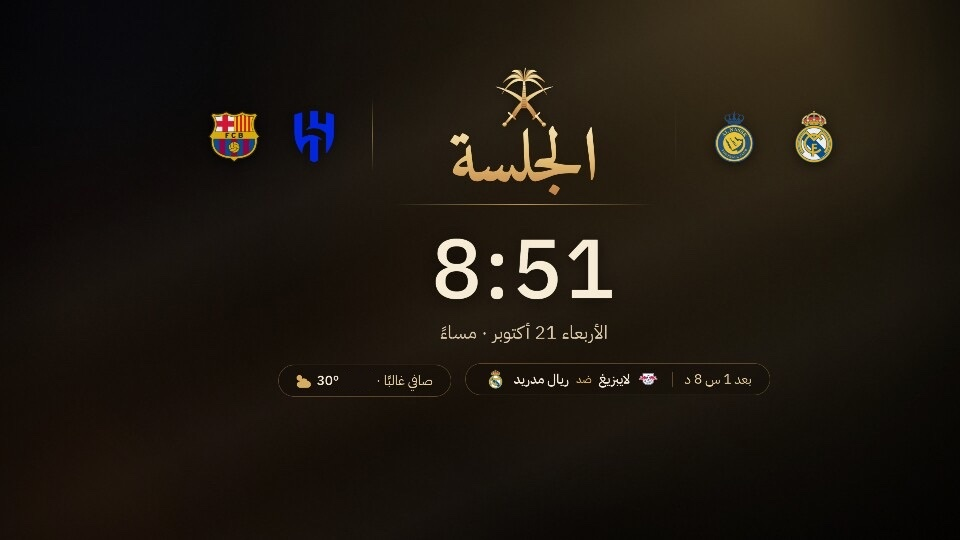 |
| الشاشة الرئيسية | شاشة التوقف |
| 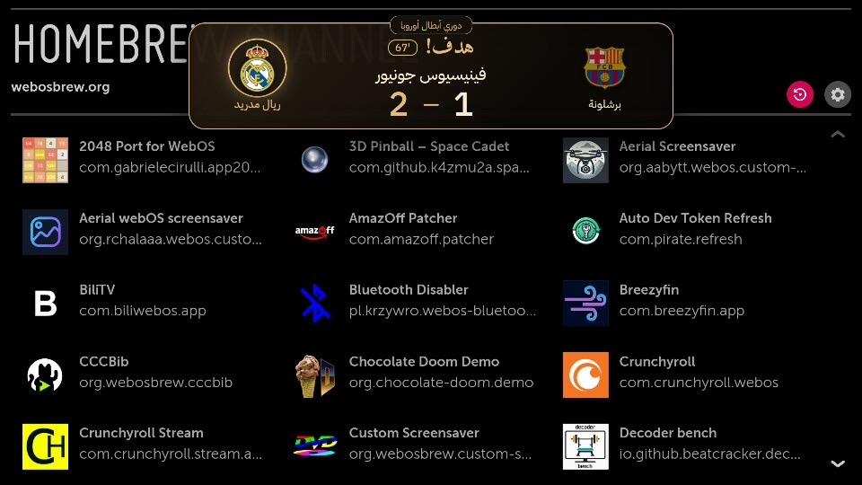 | 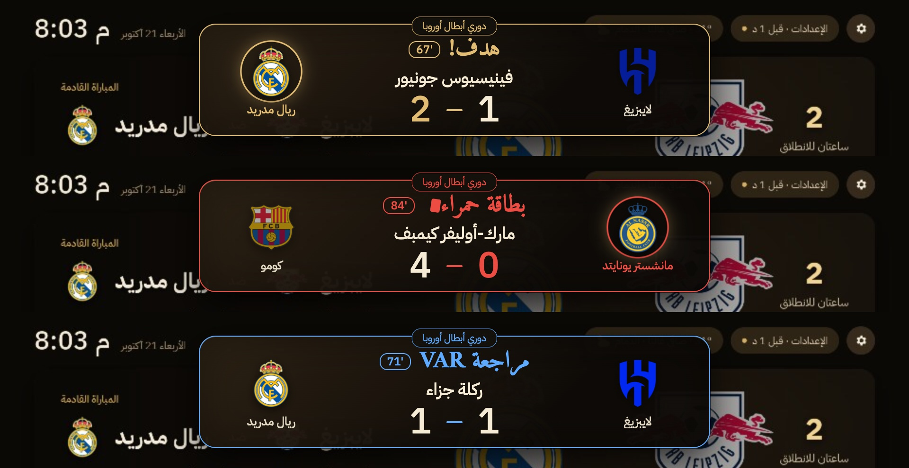 |
| تنبيه هدف فوق أي تطبيق | أنواع التنبيهات |

| 🟢 Google TV | |
|:---:|:---:|
| 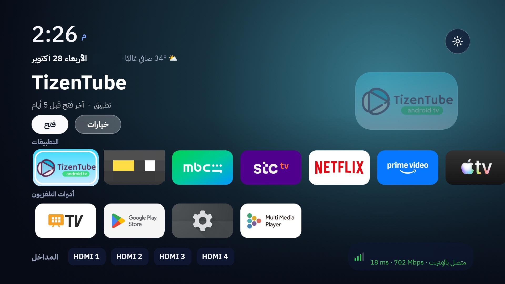 | 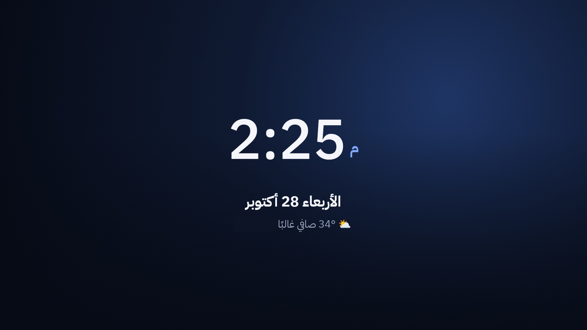 |
| الشاشة الرئيسية | شاشة الانتظار |
| 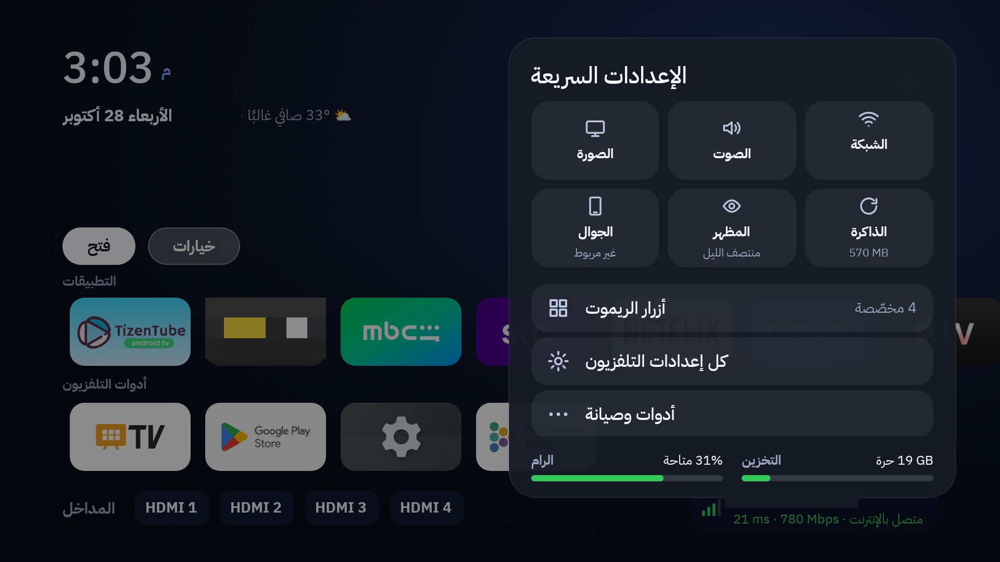 | 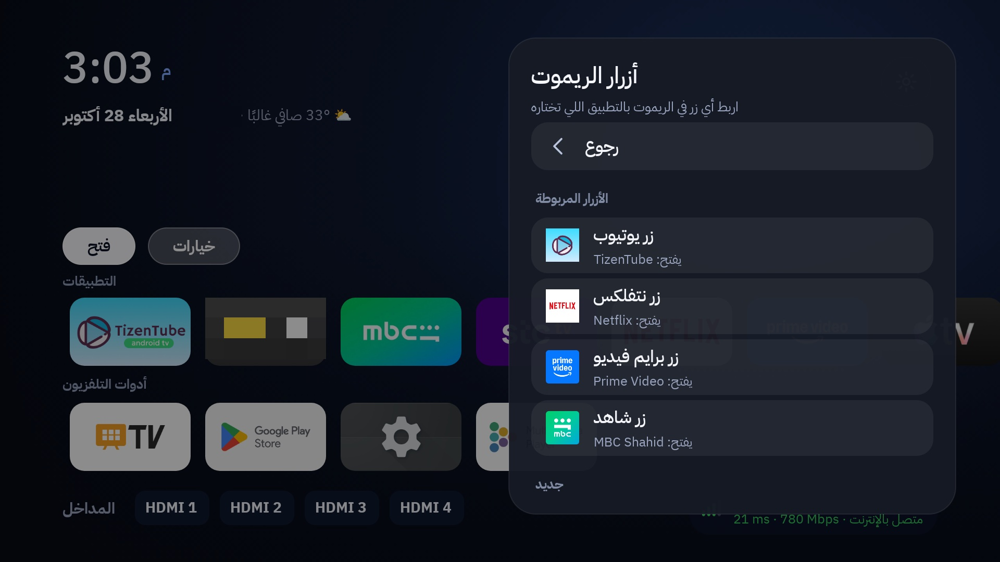 |
| الإعدادات السريعة | أزرار الريموت بكيفك |
| 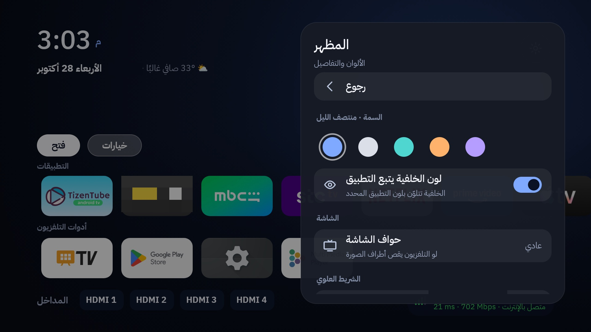 | 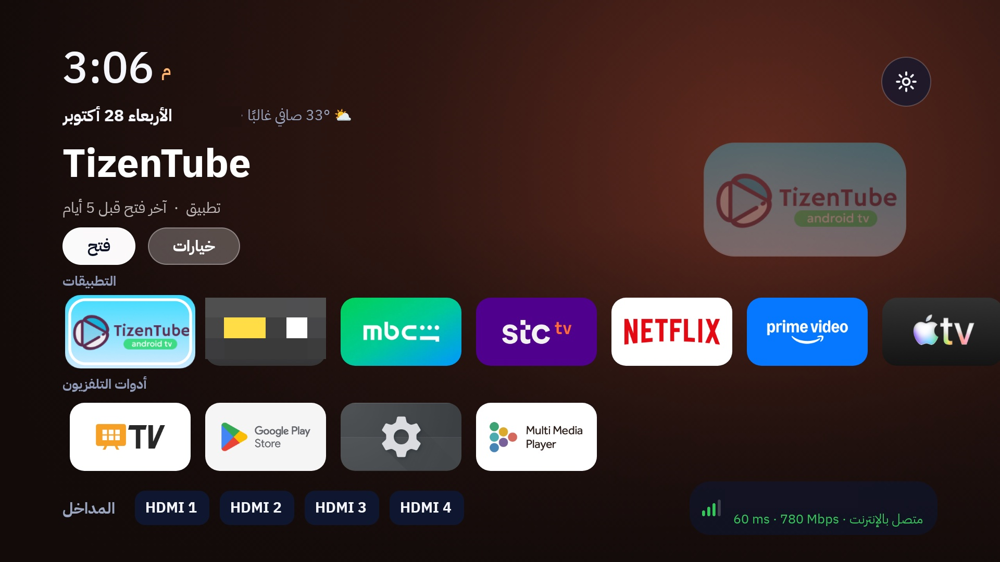 |
| المظهر والسمات | سمة «غروب» |
| 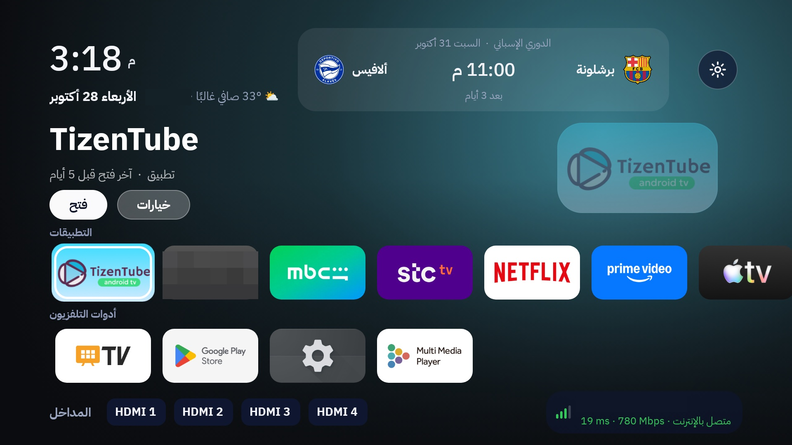 | 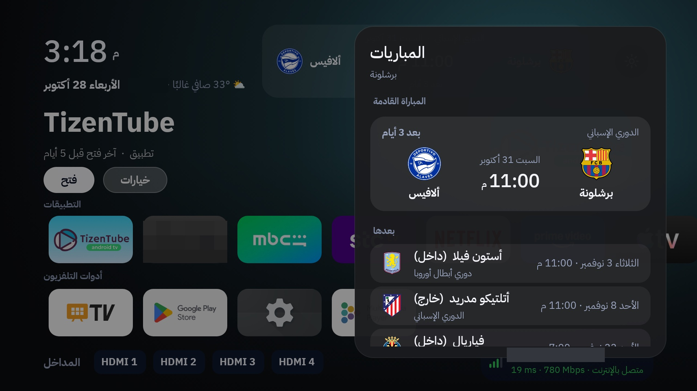 |
| بطاقة المباراة (اختيارية) | قائمة المباريات |

*(حجبنا اسم الشبكة والمدينة وبعض التطبيقات من اللقطات حفاظاً على الخصوصية.)*

### هيكل المستودع
```
.
├── lg-webos/                 🔴 LG webOS
│   ├── app/                  الواجهة
│   ├── service/              الخدمة الجذرية وتنبيهات UEFA
│   ├── alert/                تطبيق بطاقة التنبيه
│   ├── scripts/              تثبيت ورفع وتراجع
│   ├── tools/                مولّدات الخلفية والاختبارات
│   └── docs/                 وثائق مفصلة ثنائية اللغة
├── google-tv/                🟢 Google TV
│   ├── albrhi-widget/        مصدر التطبيق وبناؤه
│   └── albrhi-tv-restore/    حزمة الاسترجاع والأدوات
├── README.md · AGENTS.md · llms.txt · CLAUDE.md · LICENSE
```

### ابدأ
```bash
git clone https://github.com/ibrahim2100/smart-tv-mods.git
cd smart-tv-mods
```
ثم:
- **LG:** `cd lg-webos && npm install && cp scripts/tv.conf.example scripts/tv.conf` وكمّل من [`lg-webos/docs/INSTALL.md`](lg-webos/docs/INSTALL.md).
- **Google TV:** `cd google-tv/albrhi-widget && ./build.sh && ./pack.sh` ثم `cd ../albrhi-tv-restore && cp device.conf.example device.conf && ./restore.sh` (التفاصيل في [`google-tv/README.md`](google-tv/README.md)).
- **أو اترك الوكيل يسويها:** استخدم الطلب اللي في أول الصفحة.

### المتطلبات: الروت (LG) / USB Debugging (Android)

لا يشتغل المشروعان على تلفزيون «على حالته». لازم تفتح صلاحيات الوصول أول (روت لـLG، وUSB debugging لـAndroid):

**🔴 LG webOS (يحتاج روت، وليس وضع المطور)**
1. **لا تستخدم تطبيق Developer Mode لهذا المشروع.** وضع المطور (Developer Mode) طريق ثاني محدود: بدون روت، ويحتاج تمديد كل ~1000 ساعة، ولا يكفي للاستبدال والخدمة الجذرية هنا. والأهم: **لا تبقيه مثبّتاً أثناء الروت وبعده** — عندنا التلفزيون رفض/تعطّل معه، وإذا كان محمّلاً يتعطل الروت. لو عندك التطبيق، احذفه قبل الروت.
2. اعرف هل تلفزيونك قابل للروت: ادخل <https://cani.rootmy.tv> واكتب موديل التلفزيون وإصدار النظام (Settings ← General ← About). الطرق تعتمد على الإصدار ومعظمها يُرقَّع مع التحديثات، فلا تحدّث النظام قبل الروت.
3. نفّذ الروت بالطريقة المناسبة من [webosbrew.org/rooting](https://www.webosbrew.org/rooting/) (على تلفزيوننا webOS 7.5 استُخدمت أداة <https://e.nya.je/getroot/>، وهي مُطلِق لثغرات jsbro/dangbro/wtfbro: تضع إصدار النظام وIP التلفزيون وتتبع التعليمات). تثبّت الأداة **Homebrew Channel** وتعطيك روت. المحاولة الفاشلة آمنة غالباً، لكن لا تجرّب تغييرات عشوائية على النظام.
4. تأكد من الاتصال: `nc <ip-التلفزيون> 23` يعطيك `#` (طرفية روت telnet من Homebrew Channel). السكربتات تستخدم هذا المنفذ.
5. الكمبيوتر والتلفزيون على نفس الشبكة، وضع العنوان في `lg-webos/scripts/tv.conf`.
> ⚠️ الروت قد يزول بعد تحديث النظام. وبورت 23 روت بلا كلمة سر لكل من على شبكتك، لا تفتحه للإنترنت.

**🟢 Google TV / Android TV (بدون روت)**
1. الإعدادات ← النظام ← حول ← اضغط **Build** 7 مرات لتفعيل خيارات المطور.
2. خيارات المطور ← فعّل **USB debugging** (وفي Android 11+ فعّل أيضاً **Wireless debugging**).
3. من الكمبيوتر: `adb connect <ip-التلفزيون>:5555` ثم **اقبل رسالة «Allow USB debugging?» على شاشة التلفزيون** (فعّل «Always allow»). `adb devices` لازم يعرض `device` لا `unauthorized`.
4. ضع العنوان في `google-tv/albrhi-tv-restore/device.conf`.

### 🤖 صُنع بوكيل ذكاء اصطناعي
هذا المستودع **كتبه وكيل ذكاء اصطناعي**: [Claude](https://claude.com/claude-code) من Anthropic (Claude Code) بتوجيه **إبراهيم آل رهن** الذي حدد المطلوب وجرّب كل شي على تلفزيونيه الحقيقيين وصحّح المسار. الفضل في كتابة الكود والتوثيق وتحليل الأعطال يعود للوكيل (Claude)، والقرار والتجربة والملكية لصاحب المشروع. ما كُتب هنا يُظهر أن وكيلاً يقدر يبني ويختبر ويوثق ويرفع مشروعاً كاملاً على أجهزة حقيقية إذا توفرت له الصلاحيات الصحيحة.

### 🧠 لأي نموذج ذكاء اصطناعي يقرأ المستودع
المستودع مصمم بحيث يقدر أي نموذج (Claude، GPT، Gemini، Codex، Cursor…) **يفهمه كاملاً، ينفذه على تلفزيونك، أو يبني نسخته الخاصة**:
- [`AGENTS.md`](AGENTS.md): الدليل الكامل (المتطلبات، التشغيل خطوة بخطوة، نقاط التخصيص لكل مشروع، قواعد الأمان، قائمة التحقق).
- [`llms.txt`](llms.txt): فهرس مختصر للنماذج. و`CLAUDE.md` يحيل إلى `AGENTS.md`.

لبناء نسختك: «اقرأ AGENTS.md ثم اصنع نسخة خاصة بي: فريقي [X]، تطبيقاتي [..]، لغتي [..]، وتلفزيوني [الموديل].»

### الخصوصية والأمان في المستودع
- **لا شي خاص مرفوع:** لا عناوين IP حقيقية (أمثلة فقط: `tv.conf.example` و`device.conf.example`)، لا مفاتيح توقيع (`*.keystore` محجوبة)، لا نسخ احتياطية للتلفزيون، لا ملفات APK، لا رموز (tokens)، ولا إيميلات (الالتزامات بعنوان GitHub noreply).
- الشعارات والأيقونات (علامات تجارية) **غير مخزّنة**؛ تُسحب بـ`lg-webos/scripts/fetch-assets.sh` عندك محلياً.
- ملفات إعدادك المحلية (`tv.conf`، `device.conf`) في `.gitignore`، ورمز المكيف يبقى على التلفزيون فقط.

### المساهمة
- افتح Issue أو Pull Request. اذكر أي تلفزيون وإصدار النظام.
- قبل أي تعديل في LG: `cd lg-webos && npm test`، واقرأ [`lg-webos/docs/LESSONS.md`](lg-webos/docs/LESSONS.md) (قواعد مهمة، مثل: لا تقتل عملية الهوم).
- ملاحظات للمطوّر ولـClaude: [`CLAUDE.md`](CLAUDE.md).

### الرخصة والشكر
MIT (انظر [`LICENSE`](LICENSE) و[`lg-webos/LICENSE`](lg-webos/LICENSE)). الخطوط: IBM Plex Sans Arabic وAmiri (SIL OFL 1.1). فكرة استبدال الهوم في webOS مأخوذة من [zzeppieri/webos-custom-home](https://github.com/zzeppieri/webos-custom-home) (MIT)؛ الروت عبر [webosbrew](https://github.com/webosbrew) ودليل <https://e.nya.je/getroot/>. البيانات: UEFA وESPN وOpen-Meteo وipwho.is. التحكم بالمكيف عبر [Voice Monkey](https://voicemonkey.io) وAlexa. الشعارات علامات تجارية لأصحابها.

---

## English

### At a glance
| | 🔴 [`lg-webos/`](lg-webos) — Aljalsa | 🟢 [`google-tv/`](google-tv) — Albrhi Home |
|---|---|---|
| **TV** | LG webOS 7.5, **rooted** (Homebrew Channel) | Haier MatrixTV BE — Google TV / Android 14 (**no root**) |
| **What** | A web home screen + a root service + Champions League alerts over any app | A calm Android launcher: themes, quick settings, your own remote buttons, AC control, phone pairing |
| **Stack** | JavaScript (no build) and Node.js | Java (Android SDK, no Gradle) |
| **Tooling** | telnet port 23, `scripts/*.sh`, `npm test` | `adb`, `build.sh`, `restore.sh` |
| **Docs** | [lg-webos/README.md](lg-webos/README.md) and [`docs/`](lg-webos/docs) | [google-tv/README.md](google-tv/README.md) |
| **Status** | active | stable |

One repository, two **completely separate** projects (no shared code or scripts). You own an **LG** → go to `lg-webos/`. You own a **Google TV / Android TV** → go to `google-tv/`. Run scripts only from inside their own project: `adb` scripts are for Google TV, telnet scripts for LG.

### 🟢 Google TV (Albrhi Home): every feature

**Home screen**
- A large clock and date (Hijri optional), weather and a greeting with your name, in a calm design with no boxes.
- Tidy rows: **your apps**, **TV tools**, **inputs (HDMI)** with network status.
- The selected app's name and artwork, and a soft dark background that **takes the app's colour** with a smooth cross-fade.
- **Long-press OK:** move, rename, hide, delete (or app info for system apps). Order is saved.
- A calm **screensaver**: a large clock drifting slowly to protect the panel.

**Quick settings**
- A calm side panel: tiles for picture, sound, network, phone, appearance and memory, quiet rows (all TV settings, tools and maintenance), and RAM/storage meters.
- Real on/off switches, and **every change applies instantly** (the panel stays open), and cancelling is instant too.

**Appearance**
- **5 colour themes:** Midnight, Graphite, Ocean, Sunset, Violet. The background follows the app's colour or not.
- 12/24-hour clock, Hijri date, weather, the name in the greeting, and screen edges (for TVs that crop the picture).

**Remote buttons, your way**
- Link **any button** on your remote (YouTube, Netflix, Prime, Shahid, colour keys, numbers…) to any app you choose. Works with any remote and any number of buttons.
- Quick settings → **Remote buttons** → "Add a button" → press it → pick the app. The essential keys (arrows, OK, Back, Home, volume, power) are protected.

**🌬️ AC (and Alexa device) control from the remote** *(optional)*
- **Green** turns the AC on, **red** turns it off, **yellow** sets 21° (an example: you choose the buttons and commands).
- A calm status card on screen: "AC turned on", "AC turned off", "Temperature set 21°".
- An "AC" panel in quick settings with your commands, and any command can be linked to any button.
- It goes through Voice Monkey and an Alexa routine (Alexa has no public API for outside apps). Commands are one-way: **the AC's state is not read back**.
- Full guide and setup: [google-tv/README.md](google-tv/README.md#ac-control-through-alexa-optional).

**Phone pairing**
- A web page on your home network: a **full remote** (arrows, OK, volume, typing, play a video link, screen off).
- Install, uninstall and open apps, and APK upload. A 6-digit pairing code per device, and every install needs confirmation on the TV.

**Sports** *(optional, off by default)*
- A next-match card with both crests and a countdown, a fixtures panel, and alerts (before the match, kick-off, full time, fixture changes). While off it downloads nothing and sends no alerts.

**Performance and resilience**
- Smooth motion (only transform and opacity are animated) and pre-rendered tile pictures: 90th percentile frame time from 32 to **25 ms**, janky frames from 3.0% to **0.6%**.
- **Memory cleaner**, manual or automatic before launching an app (background apps only).
- An **emergency screen** if the launcher crashes 3 times in 2 minutes, an optional daily backup of layout, names and buttons, and an accessibility service that switches itself back on if Android turns it off.

**Restore kit (`albrhi-tv-restore/`)**
- `restore.sh` re-applies everything after a system update, `revert.sh` returns the TV to stock, `backup.sh`, and `check.sh` / `selftest.sh` to verify and measure. It also disables extra Haier/MediaTek apps (reversible).

### 🔴 LG webOS (Aljalsa): every feature

**Interface**
- **Separate rows:** your apps, inputs (HDMI with PlayStation, beIN and other logos), system (essentials only).
- **Auto-discovery:** an app you install shows up with its icon, an app you delete disappears.
- **Smooth motion:** 55–60 fps, about 25 ms from key press to paint, and the app's colour floods the screen when you open it.
- **Long-press:** move, hide, or **really delete** from the TV with confirmation. System apps and Homebrew are protected.
- A **match card** for your teams (Barcelona, Real Madrid, Al-Hilal and Al-Nassr by default) with a countdown, score and minute.
- **Weather** for your city, and **Arabic names** for teams, leagues and cities.
- A branded **screensaver** after idling (logo, clock, weather, next match) that replaces LG's own and its ads.

**Alerts** *(Champions League only)*
- From the official **UEFA** feed: kick-off, goal (with player and minute, own goal or penalty), goal cancelled, red card, penalty, VAR, half-time, full time.
- Shown as a card over **any app, even Netflix**; it polls every 5 seconds during a match and sleeps in between.

**Tools and system**
- **Quick-settings panel (gear):** network, Bluetooth, sound output, volume, picture mode, **screen off while the sound keeps playing**, goal alerts, memory cleaning.
- **Memory cleaner**, manual and automatic.
- **No LG ads** (turns off `homePromotion` and screensaver ads), and one script puts everything back.
- **Self-updating** deploys, and **boot persistence** (opens the interface instead of "no signal") with the Home button working from any app.
- Tested on **webOS 7.5** (1.2 GB RAM): every design decision is built around that device's weakness.

### Screenshots

| 🔴 LG webOS | |
|:---:|:---:|
|  |  |
| Home | Screensaver |
|  |  |
| Goal alert over any app | Alert kinds |

| 🟢 Google TV | |
|:---:|:---:|
|  |  |
| Home | Screensaver |
|  |  |
| Quick settings | Your own remote buttons |
|  |  |
| Appearance and themes | "Sunset" theme |
|  |  |
| Match card (optional) | Fixtures panel |

*(The Wi-Fi name, city and a few apps are blurred in the screenshots for privacy.)*

### Repository layout
(see the tree above.)

### Getting started
```bash
git clone https://github.com/ibrahim2100/smart-tv-mods.git
cd smart-tv-mods
```
Then:
- **LG:** `cd lg-webos && npm install && cp scripts/tv.conf.example scripts/tv.conf`, then continue with [`lg-webos/docs/INSTALL.md`](lg-webos/docs/INSTALL.md).
- **Google TV:** `cd google-tv/albrhi-widget && ./build.sh && ./pack.sh`, then `cd ../albrhi-tv-restore && cp device.conf.example device.conf && ./restore.sh` (details in [`google-tv/README.md`](google-tv/README.md)).
- **Or let an agent do it:** use the prompt at the top of this page.

### Requirements: root (LG) / USB debugging (Android)

Neither project works on a TV "as shipped". You must unlock access first (root for LG, USB debugging for Android):

**🔴 LG webOS (root required, NOT Developer Mode)**
1. **Do not use the LG Developer Mode app for this project.** Developer Mode is a different, limited path: no root, it must be renewed about every 1000 h, and it is not enough for the home swap and root service. More importantly, **don't keep it installed while rooting or afterwards**: on our TV it was rejected/broke the root. If you have the app, remove it before rooting.
2. Check that your TV can be rooted: open <https://cani.rootmy.tv> with your model and firmware version (Settings → General → About). Methods depend on the firmware and most get patched by updates, so **don't update the TV before rooting**.
3. Root with the method that fits from [webosbrew.org/rooting](https://www.webosbrew.org/rooting/). (On our webOS 7.5 TV the tool <https://e.nya.je/getroot/> was used: it is a launcher for the jsbro/dangbro/wtfbro exploits where you enter the firmware version and the TV's IP and follow its steps.) It installs **Homebrew Channel** and gives root. A failed attempt is generally safe, but never make random changes to the system.
4. Check the connection: `nc <tv-ip> 23` should give a `#` prompt (the telnet root shell provided by Homebrew Channel). The scripts use this port.
5. Computer and TV on the same network; put the address in `lg-webos/scripts/tv.conf`.
> ⚠️ Root may be lost after a firmware update. Port 23 is an unauthenticated root shell for everyone on your LAN: never expose it to the internet.

**🟢 Google TV / Android TV (no root)**
1. Settings → System → About → tap **Build** 7 times to unlock Developer options.
2. Developer options → turn on **USB debugging** (on Android 11+ also **Wireless debugging**).
3. On your computer: `adb connect <tv-ip>:5555`, then **accept the "Allow USB debugging?" prompt on the TV screen** (tick "Always allow"). `adb devices` must show `device`, not `unauthorized`.
4. Put the address in `google-tv/albrhi-tv-restore/device.conf`.

### 🤖 Built by an AI agent
This repository was **written by an AI agent**: [Claude](https://claude.com/claude-code) by Anthropic (Claude Code), directed by **Ibrahim Al-Rahn**, who set the goals, tested everything on his two real TVs and steered the work. The credit for writing the code and documentation and for diagnosing the failures goes to the agent (Claude); the decisions, testing and ownership are the project owner's. It shows what an agent can build, test, document and publish on real devices when given the right access.

### 🧠 For any AI model reading this repo
The repository is structured so that any model (Claude, GPT, Gemini, Codex, Cursor…) can **understand it fully, run it on your TV, or build its own version**:
- [`AGENTS.md`](AGENTS.md): the full guide (prerequisites, step-by-step run, customisation points per project, safety rules, verification checklist).
- [`llms.txt`](llms.txt): a compact index for models; `CLAUDE.md` points to `AGENTS.md`.

To make your own: "Read AGENTS.md, then build me my own version: my team is [X], my apps are [..], my language is [..], my TV is [model]."

### Privacy and safety of this repo
- **Nothing private is committed:** no real IP addresses (examples only: `tv.conf.example`, `device.conf.example`), no signing keys (`*.keystore` ignored), no TV backups, no APKs, no tokens, no email addresses (commits use a GitHub noreply address).
- Logos and icons (trademarks) are **not stored**; pull them locally with `lg-webos/scripts/fetch-assets.sh`.
- Your local config files (`tv.conf`, `device.conf`) are git-ignored, and the AC token stays on the TV only.

### Contributing
- Open an issue or pull request; say which TV and OS version you use.
- Before changing the LG project: `cd lg-webos && npm test`, and read [`lg-webos/docs/LESSONS.md`](lg-webos/docs/LESSONS.md) (hard rules such as never killing the home process).
- Developer / Claude notes: [`CLAUDE.md`](CLAUDE.md).

### License and credits
MIT (see [`LICENSE`](LICENSE) and [`lg-webos/LICENSE`](lg-webos/LICENSE)). Fonts: IBM Plex Sans Arabic and Amiri (SIL OFL 1.1). The webOS home-swap idea comes from [zzeppieri/webos-custom-home](https://github.com/zzeppieri/webos-custom-home) (MIT); rooting via [webosbrew](https://github.com/webosbrew) and <https://e.nya.je/getroot/>. Data: UEFA, ESPN, Open-Meteo, ipwho.is. AC control through [Voice Monkey](https://voicemonkey.io) and Alexa. Logos are trademarks of their owners.
