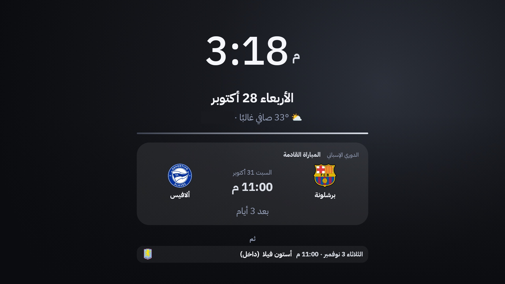
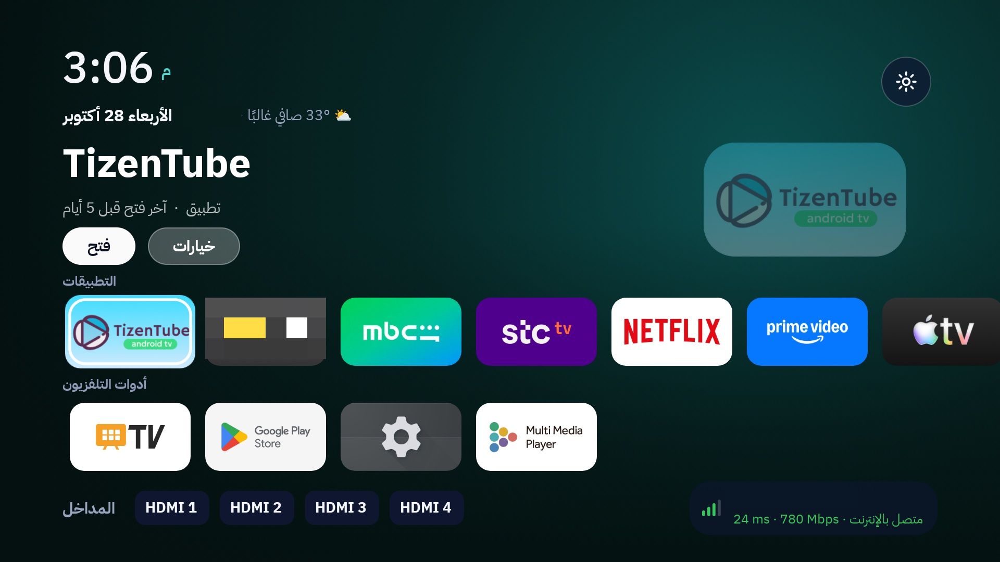
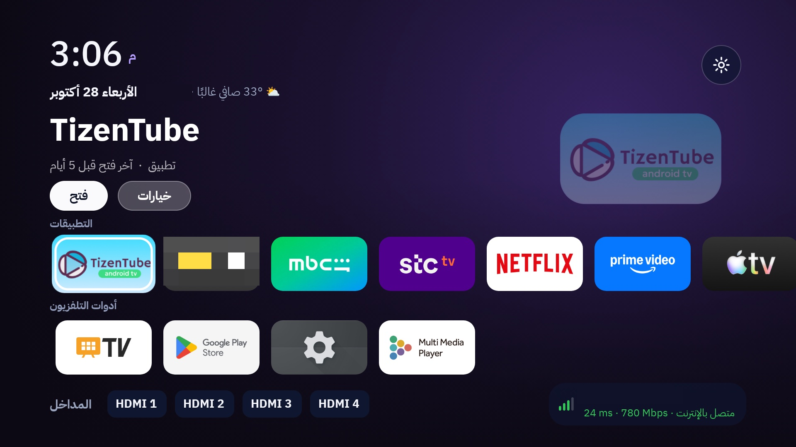

# 🟢 Google TV (Haier MatrixTV BE · Android 14)

**لانشر Android مخصص (Albrhi Home) وشاشة انتظار (Albrhi Barca) مع حزمة استرجاع كاملة** لتلفزيون Google TV.
**A custom Android launcher (Albrhi Home) and screensaver (Albrhi Barca) with a full restore kit** for a Google TV.

> هذا المجلد مشروع منفصل عن [`../lg-webos`](../lg-webos). · This folder is separate from [`../lg-webos`](../lg-webos).
> مشروع مستقر: غير مرتبط بأي خدمة سحابية، ولا يجمع بيانات. · Stable; no cloud service, no data collection.

## لقطات · Screenshots

| الشاشة الرئيسية · Home | شاشة الانتظار · Screensaver |
|:---:|:---:|
|  |  |
| الإعدادات السريعة · Quick settings | أزرار الريموت بكيفك · Your own remote buttons |
|  |  |
| المظهر والسمات · Appearance and themes | |
|  | |

**الرياضة (اختيارية، متوقفة افتراضياً) · Sports (optional, off by default)**

| بطاقة المباراة · Match card | قائمة المباريات · Fixtures panel | شاشة الانتظار · Screensaver |
|:---:|:---:|:---:|
|  |  |  |

**خمس سمات ألوان · Five colour themes** (محيط · غروب · بنفسجي · … Ocean · Sunset · Violet · …)

| | | |
|:---:|:---:|:---:|
|  |  |  |

*(حجبنا اسم الشبكة والمدينة وتطبيقاً شخصياً من اللقطات · Wi-Fi name, city and a personal app are blurred for privacy.)*

---

## العربي

### وش هو؟
تطبيق Android (Java بدون Gradle) يحل محل واجهة Google TV الرئيسية على تلفزيون Haier MatrixTV BE (Android 14). يتحكم بزر **Home**، ويضيف شاشة انتظار، وأدوات تحكم من الجوال، وحزمة سكربتات تعيد كل التعديلات لو نزل تحديث ورجّع شي، أو ترجع التلفزيون للأصل.

### المزايا
| الميزة | الشرح |
|---|---|
| **واجهة رئيسية هادئة** | ساعة كبيرة وتاريخ بدون صناديق، اسم التطبيق المحدد وصورته، وخلفية داكنة ناعمة تتلوّن بلونه. صفوف: تطبيقاتك، أدوات التلفزيون، المدخلات (HDMI) مع حالة الشبكة. |
| **أزرار الريموت بكيفك** | اربط أي زر في الريموت (يوتيوب، نتفلكس، برايم، شاهد، الألوان، الأرقام…) بأي تطبيق تختاره. الإعدادات السريعة ← **أزرار الريموت** ← «إضافة زر»: اضغط الزر ثم اختر التطبيق. يشتغل مع أي ريموت وعدد أزرار (4 أو أقل أو أكثر)، والأزرار الأساسية (الأسهم، OK، رجوع، Home، الصوت، التشغيل) محمية ولا تُربط. |
| **المكيف عبر Alexa** | تحكم بمكيفك (أو أي جهاز في Alexa) من التلفزيون: صف «المكيف» في الإعدادات السريعة بأوامرك، وأي زر في الريموت (مثلاً الأخضر للتشغيل والأحمر للإطفاء والأصفر لدرجة 21) يرسل أمراً. تظهر بطاقة حالة هادئة («تم تشغيل المكيف»، «تم ضبط الحرارة 21°»). يمر عبر Voice Monkey وروتين Alexa، وهي أوامر فقط: لا تُقرأ حالة المكيف. |
| **المظهر (قابل للتغيير)** | من الإعدادات السريعة ← **المظهر**: 5 سمات ألوان (منتصف الليل، رمادي، محيط، غروب، بنفسجي)، لون الخلفية يتبع التطبيق أو لا، الوقت 12/24 ساعة، التاريخ الهجري، الطقس، والاسم في التحية. كلها تُحفظ مع النسخة الاحتياطية. |
| **الرياضة (اختيارية، متوقفة افتراضياً)** | **بطاقة المباراة القادمة** في الأعلى (الدوري واليوم، الفريقان بشعاريهما، الوقت، والعدّ التنازلي؛ تتلوّن بلون السمة وتُبرز لما تقرب أو تبدأ). OK عليها يفتح **قائمة المباريات**: البطاقة الكبرى، التالية بشعارات الخصوم، آخر نتيجة، وتحديث يدوي. وتنبيهات: قبل المباراة بـ15 دقيقة، الانطلاق، النهاية، تغيّر الموعد. تُفعَّل من المظهر ← المباريات والتنبيهات. وهي متوقفة، لا تحمّل بيانات ولا تنبّه. |
| **ضغط مطوّل على OK** | نقل، إعادة تسمية، إخفاء، حذف (أو معلومات التطبيق لتطبيقات النظام). الترتيب محفوظ. |
| **الإعدادات السريعة** | لوحة جانبية هادئة: بلاطات للصورة والصوت والشبكة والجوال والمظهر والذاكرة، ثم صفوف خفيفة (كل إعدادات التلفزيون، أدوات وصيانة)، ومؤشرا الرام والتخزين. مفاتيح تبديل حقيقية ومنتقي ألوان السمة. حواف الشاشة (للتلفزيونات التي تقص الأطراف) تحت المظهر. |
| **ربط الجوال** | صفحة ويب على شبكة البيت: ريموت كامل (أسهم، OK، صوت، كتابة، تشغيل رابط فيديو، إطفاء الشاشة)، تثبيت وحذف وفتح التطبيقات، ورفع APK. رمز ربط من 6 أرقام لكل جهاز، وكل تثبيت يحتاج تأكيد على التلفزيون. |
| **شاشة الانتظار** | Albrhi Barca (اسمها القديم): ساعة كبيرة هادئة بألوان السمة تتحرك ببطء لحماية الشاشة. |
| **تنظيف الذاكرة** | يدوي أو تلقائي قبل فتح تطبيق لو الرام الحرة أقل من 300 ميجا (يغلق الخلفية فقط). |
| **ثبات** | شاشة طوارئ لو انهار اللانشر 3 مرات خلال دقيقتين، ونسخة احتياطية يومية اختيارية للترتيب والأسماء والأزرار المخصصة، وخدمة الإتاحة تعيد تفعيل نفسها لو أطفأها النظام. |
| **تقليل الإعلانات والتطبيقات الزائدة** | يعطّل تطبيقات Haier/MediaTek الزائدة وبعض تطبيقات Google عن المستخدم الحالي. |

### التحكم بالمكيف عبر Alexa (اختياري)
تشغّل مكيفك (أو أي جهاز عندك في Alexa) من الريموت بدون جوال: **الأخضر** يشغّل، **الأحمر** يطفي، **الأصفر** يضبط الحرارة على 21، مثلاً. وتظهر بطاقة حالة هادئة على الشاشة: «تم تشغيل المكيف»، «تم إطفاء المكيف»، «تم ضبط الحرارة 21°».

**الفكرة:** Alexa ما عندها واجهة رسمية يتحكم بها تطبيق خارجي بأجهزتك، فنستعمل جسراً اسمه [Voice Monkey](https://voicemonkey.io). كل أمر هو «Routine Trigger» تربطه بروتين في Alexa، والتلفزيون يضغطه عبر الإنترنت:
`زر الريموت ← التلفزيون ← Voice Monkey ← روتين Alexa ← المكيف`

**التجهيز (مرة وحدة):**
1. سجّل في Voice Monkey وفعّل مهارتهم في تطبيق Alexa (تأكد أن سوق حسابك في قائمة الأسواق المدعومة عندهم).
2. أنشئ **Trigger** لكل أمر، بأسماء واضحة مثل `AC On` و`AC Off` و`AC 21`.
3. في تطبيق Alexa: More ← Routines ← **+**. **When** = Smart Home ← Alexa Voice Monkey v3 ← VM Routines ← الـTrigger. **Action** = مكيفك (تشغيل، إطفاء، حرارة…). جرّب أن الروتين يشتغل.
4. من لوحة Voice Monkey أنشئ **API Token** (عامله ككلمة مرور).
5. على التلفزيون: افتح صفحة الجوال (الإعدادات السريعة ← الجوال)، وفي قسم **المكيف** الصق الرمز واضغط «حفظ وجلب الأوامر».
6. اربط الأزرار: الإعدادات السريعة ← **أزرار الريموت** ← «إضافة زر» ← اضغط زر اللون ← اختر أمر المكيف (يظهر فوق التطبيقات). أو افتح **المكيف** من الإعدادات السريعة واضغط أي أمر.

**مهم تعرفه:**
- الأوامر **باتجاه واحد**: «تم» تعني أن Voice Monkey قبل الطلب وسلّمه لـAlexa، وما تعني أن المكيف نفّذ. ولا تُعرض حرارته الحالية.
- البطاقة تفهم معنى الأمر من **اسمه** (on/off/تشغيل/إطفاء/رقم بين 16 و30)، فسمِّ أوامرك بأسماء واضحة.
- تعتمد على سحابتين (Voice Monkey وAlexa) وعلى الإنترنت. كل أمر جديد يحتاج Trigger وروتين يدوياً.
- الرمز يُحفظ على التلفزيون فقط، ولا يدخل النسخة الاحتياطية ولا هذا المستودع. لو تسرّب احذفه من لوحة Voice Monkey.

### الأداء (قياس على التلفزيون نفسه)
المشي بالأسهم على الشاشة الرئيسية (40 ضغطة)، التلفزيون يركّب 4K:

| | قبل التصميم الجديد | بعده |
|---|---|---|
| وسيط زمن الإطار | 31 ms | **21 ms** |
| الشريحة 90 | 32 ms | **25 ms** |
| الشريحة 99 | 53 ms | **30 ms** |
| إطارات متقطعة | 3.0% | **0.6%** |

ما تغيّر: صور التطبيقات تُرسم مرة وحدة بحجم البلاطة وبحواف مدوّرة (بدون قصّ في كل إطار)، والخلفية تتبدّل بتلاشي على خيط الرسم، وبلا طبقة خلفية للنافذة. القياس بنفسك: `albrhi-tv-restore/selftest.sh`.

### المتطلبات
- تلفزيون Android/Google TV مع تفعيل **Developer options ← Wireless debugging / USB debugging**.
- `adb` على جهازك (Android platform-tools).
- للبناء من المصدر: JDK 17 وAndroid SDK (build-tools 34.0.0 وplatform android-34).

### ابدأ بسرعة
```bash
cd albrhi-tv-restore
cp device.conf.example device.conf   # ضع عنوان التلفزيون، مثل 192.168.1.50:5555
./check.sh        # يفحص وش مطبّق وش لا
./restore.sh      # يثبّت اللانشر ويطبّق كل التعديلات
./revert.sh       # يرجّع التلفزيون لـGoogle TV الأصلي
```
> ملف `albrhi-widget.apk` غير مرفوع على GitHub: ابنِه أولاً (الأسفل) ثم انسخه لمجلد `albrhi-tv-restore/` (`pack.sh` يسويها).

### البناء من المصدر
```bash
cd albrhi-widget
./build.sh        # aapt2 ← javac ← d8 ← zipalign ← apksigner  (ينتج albrhi-widget.apk)
./pack.sh         # ينسخ الـAPK والمصدر إلى ../albrhi-tv-restore
```
- `build.sh` ينشئ مفتاح توقيع محلي `debug.keystore` أول مرة. **لا يُرفع على git (محجوب في `.gitignore`)، احتفظ بنسخة خاصة منه**: لو ضاع لا تقدر تحدّث التطبيق فوق نفسه.
- المسارات في `build.sh` لـmacOS (Homebrew JDK وSDK في `~/Library/Android/sdk`): عدّلها لنظامك.
- `albrhi-tv-restore/source/` نسخة مطابقة من المصدر تُحدَّث بـ`pack.sh`؛ المصدر الرئيسي في `albrhi-widget/`.

### الأدوات (`albrhi-tv-restore/`)
| الملف | الوظيفة |
|---|---|
| `restore.sh` / `revert.sh` / `check.sh` | إعادة التطبيق / الرجوع للأصل / الفحص |
| `backup.sh` | يسحب ترتيب التطبيقات والمخفية وأسماء HDMI إلى `backups/` (غير مرفوعة) |
| `install-autobackup.sh` | (اختياري) نسخة احتياطية يومية 12 ظهراً عبر launchd |
| `tvinstall.sh` | تثبيت تطبيق من الماك (APK أو مجلد splits أو xapk أو رابط)، `list`, `remove`, `launch` |
| `selftest.sh` | فحص ذاتي: النظام، الذاكرة، الاستقرار، السلاسة |
| `config.sh` | قوائم الحزم والعنوان (`device.conf` أو `ADB_DEVICE`) |

الشرح الكامل بالتفصيل (كل التعديلات على التلفزيون، الأداء، ربط الجوال وواجهته، الرجوع بدون كمبيوتر): [albrhi-tv-restore/README.md](albrhi-tv-restore/README.md).

### الأمان
- اتصال ربط الجوال HTTP داخل شبكة البيت فقط (يرفض أي عنوان خارجي) بدون تشفير؛ التوكن لا يُرسل خارج الشبكة. قرار التشفير مؤجّل ومشروح في README الحزمة.
- خدمة الإتاحة `Albrhi Remote Control` لا تقرأ الشاشة ولا تخزّن شي؛ تتحرك فقط عند طلب جوال مربوط.
- لا مفاتيح أو توكنات أو نسخ احتياطية على git. عنوان التلفزيون في `device.conf` المحلي.

---

## English

### What is it?
An Android app (plain Java, no Gradle) that replaces the Google TV home screen on a Haier MatrixTV BE (Android 14). It takes over the **Home** button, adds a screensaver and phone-based controls, and ships a script kit that re-applies every change after a system update, or reverts the TV to stock.

### Features
| Feature | Details |
|---|---|
| **Calm home screen** | A large clock and date with no boxes, the selected app's name and artwork, and a soft dark background tinted with its colour. Rows: your apps, TV tools, inputs (HDMI) with network status. |
| **Remote buttons, your way** | Link any button on your remote (YouTube, Netflix, Prime, Shahid, colour or number keys…) to any app you choose. Quick settings → **Remote buttons** → "Add a button": press the button, then pick the app. Works with any remote and any number of buttons; the essential keys (arrows, OK, Back, Home, volume, power) are protected and can't be linked. |
| **AC through Alexa** | Control your air conditioner (or any Alexa device) from the TV: an "AC" row in quick settings with your commands, and any remote button (e.g. green = on, red = off, yellow = 21°) can send one. A calm status card appears ("AC turned on", "Temperature set 21°"). It goes through Voice Monkey and an Alexa routine, and is commands only: the AC's state is not read back. |
| **Appearance (configurable)** | Quick settings → **Appearance**: 5 colour themes (Midnight, Graphite, Ocean, Sunset, Violet), background follows the app's colour or not, 12/24-hour clock, Hijri date, weather, and the name in the greeting. All saved with the layout backup. |
| **Sports (optional, off by default)** | A **next-match card** on top (league and day, both teams with their crests, the time and a countdown; it follows the theme colour and is highlighted when close or live). OK on it opens the **fixtures panel**: the big card, the following matches with opponents' crests, the last result and a manual refresh. Plus alerts (15 min before, kick-off, full time, fixture changes). Switch on in Appearance → Matches and alerts. While off it downloads nothing and sends no alerts. |
| **Long-press OK** | Move, rename, hide, delete (or app info for system apps). Order is saved. |
| **Quick settings** | A calm side panel: tiles for picture, sound, network, phone, appearance and memory, then quiet rows (all TV settings, tools and maintenance) and RAM/storage meters. Real on/off switches and a theme colour picker. Screen edges (for TVs that crop the picture) live under Appearance. |
| **Phone pairing** | A web page on your home network: full remote (arrows, OK, volume, typing, play a video link, screen off), install/uninstall/open apps, APK upload. A 6-digit pairing code per device, and every install needs confirmation on the TV. |
| **Screensaver** | Albrhi Barca (its old name): a large calm clock in the theme colours, drifting slowly to protect the panel. |
| **Memory cleaner** | Manual, or automatic before launching an app when free RAM < 300 MB (background apps only). |
| **Resilience** | Emergency screen if the launcher crashes 3 times in 2 minutes; optional daily backup of layout, names and custom buttons; the accessibility service switches itself back on if Android turns it off. |
| **Less bloat** | Disables extra Haier/MediaTek apps and some Google apps for the current user. |

### AC control through Alexa (optional)
Run your air conditioner (or any device in your Alexa account) from the remote, no phone needed: **green** turns it on, **red** turns it off, **yellow** sets 21°, for example. A calm status card appears on screen: "AC turned on", "AC turned off", "Temperature set 21°".

**How:** Alexa has no public API an outside app can use to drive your devices, so we use a bridge called [Voice Monkey](https://voicemonkey.io). Each command is a "Routine Trigger" tied to an Alexa routine, and the TV presses it over the internet:
`remote button → TV → Voice Monkey → Alexa routine → the AC`

**Setup (once):**
1. Sign up at Voice Monkey and enable their skill in the Alexa app (check that your account's marketplace is one they support).
2. Create one **Trigger** per command, with clear names such as `AC On`, `AC Off`, `AC 21`.
3. In the Alexa app: More → Routines → **+**. **When** = Smart Home → Alexa Voice Monkey v3 → VM Routines → the trigger. **Action** = your AC (power, temperature…). Test that the routine works.
4. In the Voice Monkey console create an **API Token** (treat it like a password).
5. On the TV open the phone page (Quick settings → Phone); in the **AC** card paste the token and press "Save and fetch commands".
6. Link the buttons: Quick settings → **Remote buttons** → "Add a button" → press a colour key → choose the AC command (listed above the apps). Or open **AC** in Quick settings and press any command.

**Good to know:**
- Commands are **one-way**: "done" means Voice Monkey accepted the request and handed it to Alexa, not that the AC carried it out. The AC's current temperature is not shown.
- The card works out what a command does from its **name** (on/off/تشغيل/إطفاء/a number from 16 to 30), so name your commands clearly.
- It depends on two clouds (Voice Monkey and Alexa) and the internet. Every new command needs a trigger and a routine made by hand.
- The token is kept on the TV only, never in the backup file or in this repository. If it leaks, delete it in the Voice Monkey console.

### Performance (measured on the TV)
Walking the home screen with the arrow keys (40 presses) while the TV composes 4K:

| | before the redesign | after |
|---|---|---|
| median frame time | 31 ms | **21 ms** |
| 90th percentile | 32 ms | **25 ms** |
| 99th percentile | 53 ms | **30 ms** |
| janky frames | 3.0% | **0.6%** |

What changed: app pictures are drawn once at tile size with rounded corners (no per-frame clipping), the background cross-fades on the render thread, and there is no window background underneath. Measure yourself with `albrhi-tv-restore/selftest.sh`.

### Requirements
- An Android/Google TV with **Developer options → Wireless/USB debugging** on.
- `adb` on your computer (Android platform-tools).
- To build from source: JDK 17 and the Android SDK (build-tools 34.0.0, platform android-34).

### Quick start
```bash
cd albrhi-tv-restore
cp device.conf.example device.conf   # put your TV's address in, e.g. 192.168.1.50:5555
./check.sh        # what is applied, what is not
./restore.sh      # installs the launcher and applies every customisation
./revert.sh       # puts the TV back to stock Google TV
```
> `albrhi-widget.apk` is not stored on GitHub: build it first (below) and copy it into `albrhi-tv-restore/` (`pack.sh` does that).

### Build from source
```bash
cd albrhi-widget
./build.sh        # aapt2 → javac → d8 → zipalign → apksigner  (produces albrhi-widget.apk)
./pack.sh         # copies the APK and source into ../albrhi-tv-restore
```
- `build.sh` generates a local signing key `debug.keystore` the first time. **It is git-ignored; keep a private copy**: without it you can't update the app in place.
- Paths in `build.sh` assume macOS (Homebrew JDK, SDK in `~/Library/Android/sdk`): adjust for your system.
- `albrhi-tv-restore/source/` is an identical copy of the source refreshed by `pack.sh`; the main source is `albrhi-widget/`.

### Tools (`albrhi-tv-restore/`)
| File | Purpose |
|---|---|
| `restore.sh` / `revert.sh` / `check.sh` | re-apply / revert to stock / health check |
| `backup.sh` | pulls app order, hidden apps and HDMI names into `backups/` (not committed) |
| `install-autobackup.sh` | (optional) daily 12:00 backup via launchd |
| `tvinstall.sh` | install an app from your Mac (APK, splits folder, xapk or URL); `list`, `remove`, `launch` |
| `selftest.sh` | self-test: system, memory, stability, smoothness |
| `config.sh` | package lists and address (`device.conf` or `ADB_DEVICE`) |

The full Arabic reference (every change made to the TV, performance notes, phone pairing and its API, no-computer revert paths): [albrhi-tv-restore/README.md](albrhi-tv-restore/README.md).

### Security
- Phone pairing is plain HTTP on your home network only (it rejects any outside address), unencrypted; the token never leaves the LAN. The encryption decision is deferred and explained in the kit's README.
- The `Albrhi Remote Control` accessibility service doesn't read or store the screen; it acts only on requests from a paired phone.
- No keys, tokens or backups in git. The TV address lives in your local `device.conf`.
